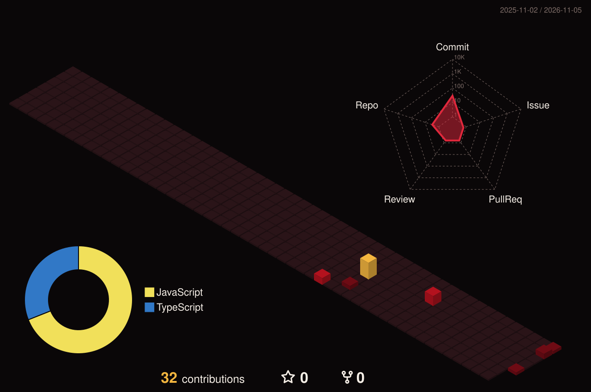

<!-- ⚡ SUIT-UP SEQUENCE -->

  

<!-- 🛰️ MISSION BRIEF -->

  

<!-- 🧰 THE ARMORY -->

  

<!-- 🪪 CLEARANCE BADGE + FIELD TELEMETRY -->

  

## 🛡️ Mission Log — Enterprise Builds

<table>
<tr><th>Mission</th><th>What it does</th><th>Armor used</th><th align="center">Status</th></tr>
<tr><td><b>ACS Intelligent Teams Bot</b></td><td>AI incident-response meeting bot — joins Teams calls through Azure Communication Services, live transcription with speaker diarisation, real-time streaming to operators, Azure OpenAI summaries and automatic ServiceNow tickets</td><td><code>.NET 9</code> <code>Blazor</code> <code>ACS</code> <code>Speech SDK</code> <code>SignalR</code> <code>Azure OpenAI</code> <code>OpenTelemetry</code></td><td align="center">⚙️ Active</td></tr>
<tr><td><b>GitHub Actions &amp; Copilot Metrics</b></td><td>Trigger, monitor and stream logs for workflows across many repos from one UI, plus a Copilot usage dashboard with Redis caching and Key Vault–secured tokens</td><td><code>.NET 9</code> <code>Blazor</code> <code>GitHub REST API</code> <code>Redis</code> <code>Key Vault</code> <code>MudBlazor</code></td><td align="center">⚙️ Active</td></tr>
<tr><td><b>Developer Productivity Analytics</b></td><td>Scheduled GitHub data collection into Azure Table Storage, weekly per-developer KPIs and team roll-ups, Copilot adoption tracking, CSV/Excel export</td><td><code>BackgroundService</code> <code>Table Storage</code> <code>Managed Identity</code> <code>EF Core</code> <code>OData</code></td><td align="center">⚙️ Active</td></tr>
<tr><td><b>BIMS — Data Warehouse</b></td><td>Patient, financial and radiology analytics for Presbyterian Intercommunity Hospital</td><td><code>ASP.NET Core</code> <code>Web API</code> <code>SQL Server</code> <code>SSIS</code> <code>SSRS</code></td><td align="center">✅ Shipped</td></tr>
<tr><td><b>Security Dashboard</b></td><td>Real-time compliance monitoring — server and desktop patching, antivirus, perimeter scans</td><td><code>ASP.NET Core</code> <code>Web API</code> <code>SQL Server</code></td><td align="center">✅ Shipped</td></tr>
<tr><td><b>xTrack</b></td><td>Windows security monitoring for file, app, internet and removable-media activity, with a web portal and remote push install</td><td><code>C#</code> <code>Windows Service</code> <code>MySQL</code> <code>SQLite</code></td><td align="center">✅ Shipped</td></tr>
</table>

## 🚀 Field Deployments — Client Launches

<table>
<tr><th>Launch</th><th>Sector</th><th align="center">Live</th></tr>
<tr><td><b>SkillTech Club</b></td><td>EdTech · Azure &amp; AI</td><td align="center"><a href="https://skilltech.club/">skilltech.club ↗</a></td></tr>
<tr><td><b>AI International School</b></td><td>Web</td><td align="center"><a href="https://www.aiinternationalschool.com">aiinternationalschool.com ↗</a></td></tr>
<tr><td><b>Aries Tokyo</b></td><td>E-commerce</td><td align="center"><a href="https://www.ariestokyo.com">ariestokyo.com ↗</a></td></tr>
<tr><td><b>Veg Mantra Store</b></td><td>E-commerce</td><td align="center"><a href="https://vegmantrastore.com">vegmantrastore.com ↗</a></td></tr>
<tr><td><b>Japan Jewelry Company</b></td><td>Web</td><td align="center"><a href="https://www.japanjewelrycompany.com">japanjewelrycompany.com ↗</a></td></tr>
<tr><td><b>Wee Green</b></td><td>Web</td><td align="center"><a href="https://wee.green">wee.green ↗</a></td></tr>
</table>

> *“Amit is super supportive in his work. If you ask him to work on a project, he delivers it in no time.”*
>
> — **Arti Rupda**, CEO, ARKIT · Japan Jewelry Company

<b>🎖️ Certifications, honours &amp; training</b>

 

| | |
|---|---|
| 🛡️ **Professional Scrum Developer I** (PSD I) | Scrum.org |
| ⚡ **MCSD** — Developing Windows Azure and Web Services | Microsoft |
| 🎯 **Microsoft Specialist** — Programming in HTML5 with JavaScript &amp; CSS3 | Microsoft |
| 🧩 **MCP** — Developing ASP.NET MVC Web Applications | Microsoft |
| 🧱 **MTA** — Software Development Fundamentals | Microsoft |
| 🗄️ **Querying Microsoft SQL Server 2012/2014** | Microsoft |
| 📚 Angular: Workflows · Developing for Web Performance | LinkedIn Learning |
| 🏅 **Level Four Spot Award** ×4 · **CLEAR Award** (Nov 2017, Aug 2020) | Allscripts |
| 🎓 **MCA** — S.K. Patel Institute of Management &amp; Computer Studies (2009–2012) | |
| 🎓 **BCA** — J.G. College of Computer Applications (2006–2009) | |

 

### 🏙️ Commit skyline

*Every commit powers up another tower — rebuilt automatically every day.*

  

<!-- 📡 OPEN CHANNEL -->

  

  

🏃 Off-duty: long-distance running · camping · hiking &amp; backpacking

